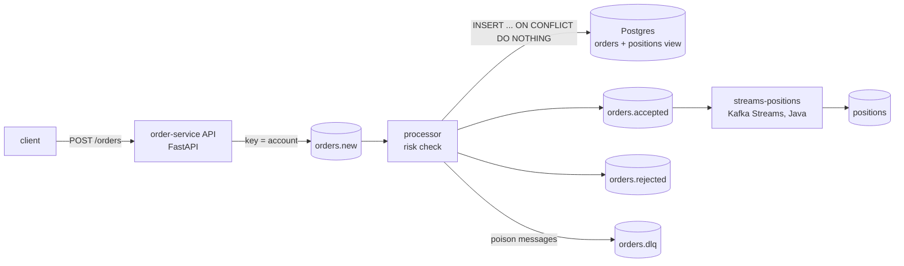

# kafka-order-testkit

A small order-event pipeline (Python API + worker, Java Kafka Streams consumer) and the tests
that pin down how it behaves under duplicates, crashes, replays, poison messages and broker outages.
The system is intentionally small. The tests are the point of the repo.

## System



| Path | What it is |
|---|---|
| `contracts/` | JSON Schemas shared by the Python producer and the JVM consumer, plus one example event. Both test suites validate against these files. |
| `order-service/` | Python 3.11. `api.py` validates the body against `order-new.schema.json`, publishes to `orders.new` keyed by account and returns 202, or 503 if Kafka does not ack within `PUBLISH_TIMEOUT_S`. `processor.py` is the consumer worker. `sql/schema.sql` holds the `orders` table and the `positions` view. |
| `streams-positions/` | Java 21 Kafka Streams topology. It reads `orders.accepted`, drops duplicate `order_id`s, and emits the net signed position per `account\|symbol`. |
| `perf/order_load.ts` | k6 load test (open model, threshold-gated). |

`X-Correlation-ID` is taken from the request, or generated if absent. It is carried as a Kafka
header to every output event and stored on the DB row. Logs are one JSON object per line and
include `correlation_id`.

## Delivery semantics

| Stage | Guarantee | How |
|---|---|---|
| API → `orders.new` | 202 only after the broker acks | Idempotent producer (`acks=all`), bounded wait. A 503 means the outcome is unknown, so the client retries with the **same** `order_id`. |
| `orders.new` → processor | at-least-once | `enable.auto.commit=false`. The offset is committed only after the DB write **and** the output event are acked. |
| DB effect | idempotent | `order_id` is the primary key and the insert is `ON CONFLICT DO NOTHING`. A redelivery re-emits the decision **already stored**. It never re-decides. |
| processor → `orders.accepted/rejected` | at-least-once | Duplicates are possible after a crash or replay, so consumers must dedupe on `order_id`. |
| `orders.accepted` → `positions` | effectively once per `order_id` | A state store of seen `order_id`s. The app runs with `exactly_once_v2`. |
| Poison messages | parked, never blocking | Bad JSON or a schema violation goes to `orders.dlq` as raw bytes with `error` and `source` headers, and is then committed. |
| DB or Kafka down in the worker | retried, never parked | The worker raises without committing and exits. Compose restarts it. |

Ordering: Kafka orders messages within a partition. Every producer keys by account and uses
`murmur2` (the same hash as the Java client; librdkafka defaults to CRC32), so each account's
orders stay in sequence end to end.

## What the tests prove

Integration tests use real Kafka (`confluentinc/cp-kafka:7.6.1`, KRaft) and Postgres via
Testcontainers. The containers are started once per session. Each test gets its own topics,
consumer group and order ids. Waits poll for a condition with a deadline: there are no bare
sleeps and no retries. `processors.drain()` waits until the consumer group has committed
everything on `orders.new`. Because the processor commits last, every side effect is visible
once `drain()` returns. If every processor has died, `drain()` fails at once with that
processor's exception.

| Risk | Test | File |
|---|---|---|
| Order lost or mangled between API, Kafka, DB and the output topic; correlation id dropped | `test_happy_path_preserves_correlation_id_end_to_end` | `order-service/tests/integration/test_pipeline.py` |
| Risk limit not enforced | `test_order_over_risk_limit_is_rejected`, `tests/unit/test_risk.py` | same; unit |
| Producer emits events the Java consumer can't read | `test_processor_output_satisfies_the_shared_contract` (real output vs schema); `ContractTest` (schema vs consumer fixtures, plus 8 violations it must reject) | `test_pipeline.py`; `streams-positions/src/test/.../ContractTest.java` |
| Duplicate delivery double-books an order | `test_same_order_delivered_twice_creates_one_row` | `test_delivery_semantics.py` |
| Crash after side effects but before the offset commit | `test_crash_after_side_effects_but_before_commit_is_replayed_safely` (a subclass raises in `_commit`, then a restart redelivers: 1 row, 2 events, same `order_id`) | `test_delivery_semantics.py` |
| Replaying the topic corrupts state | `test_replay_from_earliest_creates_no_duplicate_rows` (resets the group offsets with AdminClient and asserts every order was really reprocessed) | `test_delivery_semantics.py` |
| One bad message blocks a partition | `test_poison_messages_go_to_dlq_without_blocking_the_partition` (bad JSON and a schema violation on the same key as a valid order) | `test_delivery_semantics.py` |
| Per-account order broken across partitions | `test_orders_for_one_account_are_processed_in_sequence` (6 accounts × 15 interleaved orders on 3 partitions) | `test_ordering.py` |
| API hangs when the broker hangs; no recovery | `test_api_returns_503_within_timeout_during_outage_and_recovers` (`docker pause` on the broker, so connections stay open and nothing answers) | `test_resilience.py` |
| DB positions disagree with what was traded | `test_positions_view_matches_independently_computed_positions` (seeded random orders, some over the limit; the expected positions come from plain arithmetic in the test, not from the service's risk code) | `test_reconciliation.py` |
| Offset committed before side effects are durable | `test_valid_order_is_saved_then_published_then_committed` and 5 other fakes-based tests on the order of side effects | `tests/unit/test_processor.py` |
| Positions netting, duplicates, malformed input | `PositionsTopologyTest` (TopologyTestDriver, no broker) | `streams-positions/src/test/.../PositionsTopologyTest.java` |

Unit tests (`tests/unit/`) cover schema validation, Decimal notional arithmetic, serialisation,
and the API with a fake publisher (202 / 400 / 503, correlation id).

I mutation-checked two integration tests by hand. With the Kafka key removed, the ordering test
fails. With `ON CONFLICT` removed, the idempotency tests fail with the processor's
`UniqueViolation`.

## Running it

Prerequisites: Docker (compose v2), [uv](https://docs.astral.sh/uv/), Java 21 and Maven.

```bash
make test-unit          # ~1 s
make test-integration   # ~20 s, Docker required
make test-java          # mvn -q -B test
make lint               # ruff
make up                 # Kafka, Postgres, API (:8000), processor
make perf               # make up, then k6; exits non-zero on any threshold breach
make down               # stop everything, remove volumes
```

`make perf` accepts `RATE`, `DURATION` and `P99_MS`, e.g. `make perf RATE=200 DURATION=20s`.

## Performance baseline

Measured on an Apple M5 Max laptop with Docker Desktop 29.2 (10 CPUs, 7.6 GB). Single
uvicorn process, single-broker Kafka, everything in containers on one machine. k6 2.3.0 runs in
a container on the same Docker network. Treat these numbers as a regression baseline, not a
capacity claim.

`make perf` (1,000 req/s for 60 s, constant-arrival-rate, fresh stack):

| Metric | Value |
|---|---|
| Requests | 60,000 at 999.98 req/s, 0 dropped iterations |
| Failed | 0.00 % (all 202) |
| p50 / p95 / p99 / max | 2.13 ms / 3.47 ms / 3.76 ms / 14.03 ms |
| Data check after the run (manual) | 60,000 rows in `orders`, 60,000 distinct `order_id`s |

An earlier identical run gave p99 3.74 ms, with consumer lag 0 checked afterwards.

Exploratory runs (30 s each) to find the knee:

| Rate | p99 | Notes |
|---|---|---|
| 200 req/s (60 s) | 3.91 ms | |
| 2,000 req/s | 3.74 ms | |
| 3,000 req/s | 4.20 ms | Processor lag starts to grow |
| 5,000 req/s | 10.58 ms | API saturating, and k6 dropped 192 iterations |

The processor sustained about 2,000 msg/s while draining a backlog. It flushes the producer and
commits per message, so it is slower than the API by design.

Threshold choice: the gate is `p(99) < 25 ms` at 1,000 req/s, about 6× the measured ~4 ms. That
leaves room for laptop noise, and an obvious regression still fails the gate.
`http_req_failed < 1 %`, `checks > 99 %` and `dropped_iterations == 0` are also gates. The last
one means k6 really offered the target rate. CI runs a shorter smoke (200 req/s, 20 s,
p99 < 50 ms) because shared runners are noisier.

## Known simplifications

- **Per-message produce and commit in the processor.** It is easy to reason about, but it caps
  throughput. Batching would commit after each batch.
- **The Streams dedupe store grows without bound.** In production it would be a windowed or TTL
  store sized to the maximum redelivery delay.
- **`streams-positions` is tested only with TopologyTestDriver.** It is not part of
  `docker-compose.yml`, and there is no broker-backed Java test.
- **The outage test uses `docker pause`, not Toxiproxy.** That is simpler and deterministic.
  Partial failures such as latency or packet loss are not covered.
- **Single broker, replication factor 1.** Broker failover and `min.insync.replicas` behaviour
  are out of scope.
- **`/health` is liveness only.** It does not check Kafka or Postgres.
